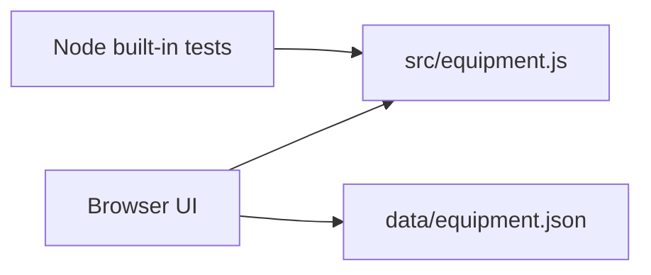

# Architecture

## Constraints

- Synthetic data only
- Browser-native HTML, CSS, and JavaScript
- Node built-in test runner
- No third-party dependencies
- Safe DOM rendering with `textContent`
- Human-controlled Git publication and review
